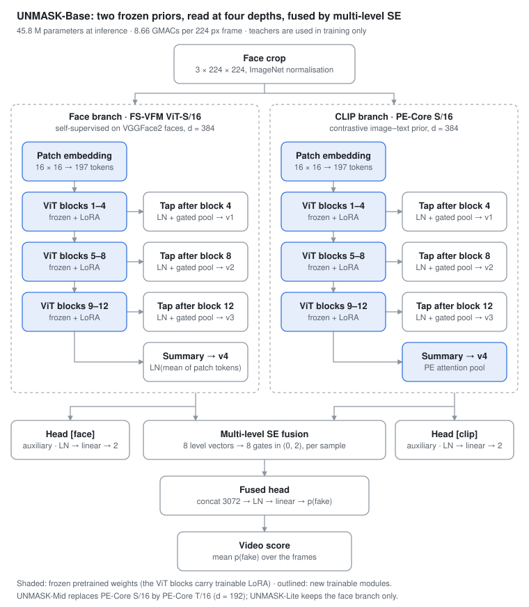
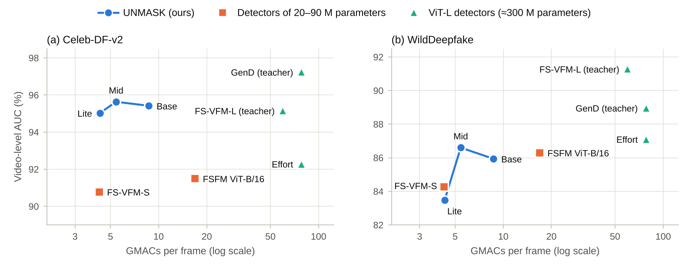
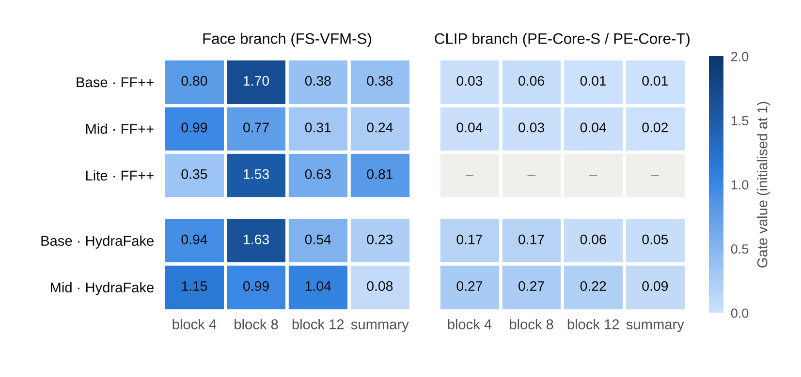

<div align="center">

# UNMASK

### A Lightweight Deepfake Detection Framework through Dual Foundation Prior Integration and Routed Multi-Teacher Knowledge Distillation for Cross-Domain Generalization

**Alam Rahmatulloh** · **Irfan Darmawan** · **Nia Ambarsari**

[](#citation)
[](LICENSE)
[](#license)


</div>

Official PyTorch implementation of **UNMASK** (**U**nified **N**etwork for **M**ulti-prior **A**daptation and **S**pecialized **K**nowledge transfer), a frame-level face-forgery detector that keeps two frozen foundation priors and learns from two large detectors, at 22–46 M parameters.

- **Two complementary frozen priors.** A face-security prior (FS-VFM ViT-S/16) and a vision–language prior (Perception Encoder PE-Core S/16 or T/16), adapted with LoRA and read at four depths.
- **Multi-level SE fusion** that starts as the identity, so training departs exactly from the pretrained representations.
- **Routed multi-teacher distillation.** FS-VFM ViT-L/16 teaches the face branch, GenD CLIP ViT-L/14 teaches the CLIP branch, with logit, pooled-feature and dense patch-token targets. Teachers are used during training only.
- **Results.** Trained on FF++ c23, UNMASK-Mid (28.2 M parameters, 5.42 GMACs) reaches **95.63 / 86.60** video AUC on Celeb-DF-v2 / WildDeepfake. On HydraFake, UNMASK-Base (45.8 M) reaches **89.8%** average accuracy, the best non-MLLM detector and 0.9 points below an ≈8 B-parameter MLLM detector, and the best Cross-Domain accuracy (**86.1%**).

## News

- **2026-11** Code, training recipes and evaluation protocols released.

## Contents

[Overview](#overview) · [Results](#results) · [Ablations](#ablations) · [Model zoo](#model-zoo) · [Installation](#installation) · [Quick start](#quick-start) · [Data](#data) · [Evaluation](#evaluation) · [Training](#training) · [Repository layout](#repository-layout) · [Citation](#citation) · [License](#license)

## Overview

<p align="center"></p>

Each frozen ViT is adapted with LoRA (rank 16 on `qkv`, `proj`, `fc1`, `fc2`) and its LayerNorms. Every branch is read at four levels: gated attention pooling of the patch tokens after blocks 4, 8 and 12, plus a summary of the last block. A multi-level squeeze-and-excitation block weights the eight level vectors per sample before the fused head; one auxiliary head per branch adds deep supervision. Video scores are the mean frame probability.

**Routed multi-teacher distillation** (training only; the projectors are discarded afterwards):

| Student read-out | Teacher | Distilled signals (loss weight) |
|---|---|---|
| face branch | FS-VFM ViT-L/16, FF++-fine-tuned (303 M), run online on the student's view | logits, T = 3 (0.25) · pooled feature, cosine (1.0) · 196 patch tokens, cosine (0.5) |
| CLIP branch | GenD CLIP ViT-L/14 (304 M), cached once over the training frames | logits, T = 3 (0.25) · pooled feature, cosine (1.0) |
| fused head | 1:1 mixture of both teachers' probabilities | logits, T = 3 (0.5) |

These terms are added to cross-entropy on the fused head (1.0, label smoothing 0.1, mixup/CutMix on half of the batches) and on the branch heads (0.5). UNMASK-Lite has no CLIP branch, so its face branch learns from both teachers.

| Variant | Branches | Params (inference) | Trainable | GMACs |
|---|---|---|---|---|
| UNMASK-Base | FS-VFM-S/16 + PE-Core-S/16 | 45.8 M | 3.13 M | 8.66 |
| UNMASK-Mid | FS-VFM-S/16 + PE-Core-T/16 | 28.2 M | 2.35 M | 5.42 |
| UNMASK-Lite | FS-VFM-S/16 | 22.0 M | 1.56 M | 4.30 |

GMACs per 224 × 224 frame count the convolution and linear layers (attention products excluded, the convention used for every model below); `tools/complexity.py` prints both counts.

## Results

### Cross-dataset generalisation (trained on FF++ c23)

AUC (%). UNMASK is trained without NeuralTextures. *Same protocol*: our measurement on the same frames (face crops resized directly to 224 × 224, no test-time augmentation; video score = mean frame probability).

| Method | Params | GMACs | CDF-v2 frame | CDF-v2 video | WDF frame | WDF video |
|---|---|---|---|---|---|---|
| *Quoted from the papers (own protocols)* | | | | | | |
| UCF (Yan et al., 2023) | – | – | 82.40 | – | – | – |
| LSDA (Yan et al., 2024) | – | – | 83.00 | 91.10 | – | – |
| SBI (Shiohara & Yamasaki, 2022) | – | – | – | 93.18 | – | – |
| LAA-Net (Nguyen et al., 2024) | – | – | – | 95.40 | – | 80.03 |
| FSFM ViT-B/16 (Wang et al., 2025) | 85.8 M | – | 85.05 | 91.44 | 85.26 | 86.96 |
| *Same protocol* | | | | | | |
| FS-VFM ViT-S/16, full fine-tuning (released) | 21.7 M | 4.24 | 83.16 | 90.78 | 81.13 | 84.27 |
| FSFM ViT-B/16 (reproduced) | 85.8 M | 16.85 | 84.50 | 91.50 | 83.80 | 86.30 |
| Effort CLIP ViT-L/14 | 303.2 M | 77.80 | 86.05 | 92.29 | 84.59 | 87.11 |
| GenD CLIP ViT-L/14 (teacher) | 304.0 M | 77.80 | 91.11 | 97.24 | 85.26 | 88.97 |
| FS-VFM ViT-L/16 (teacher) | 303.3 M | 59.65 | 87.64 | 95.16 | 88.42 | 91.29 |
| **UNMASK-Lite** | 22.0 M | 4.30 | 89.41 | 95.03 | 80.41 | 83.48 |
| **UNMASK-Mid** | 28.2 M | 5.42 | **90.12** | **95.63** | 83.27 | 86.60 |
| **UNMASK-Base** | 45.8 M | 8.66 | 88.99 | 95.42 | 82.71 | 85.94 |
| UNMASK-Base, 3 seeds (mean ± sd) | 45.8 M | 8.66 | 89.07 ± 0.22 | 95.57 ± 0.22 | 82.82 ± 0.25 | 86.17 ± 0.35 |

Bold: best among the non-teacher models. Celeb-DF-v2: 448 test videos (340 fake, 108 Celeb-real; the YouTube-real videos are absent from the pre-processed set), 14,268 frames. WildDeepfake: 806 test sequences, 32 frames each. Bootstrap 95% CIs (videos resampled within each class): UNMASK-Mid CDF-v2 video [93.7, 97.3], WDF video [84.2, 89.0].

<p align="center"></p>

### HydraFake (trained on the HydraFake training split)

Accuracy (%) with the protocol of Tan et al. (ICLR 2026): argmax decision, images resized to 224 × 224, Avg = (In-Domain + 18 out-of-domain subsets) / 19. Other rows are quoted from their Table 1.

| Method | Type | In-Domain | Cross-Model | Cross-Forgery | Cross-Domain | Avg |
|---|---|---|---|---|---|---|
| ProDet | small vision model | 90.5 | 92.3 | 76.4 | 71.4 | 80.6 |
| D3 | small vision model | 87.3 | 93.8 | 75.5 | 73.1 | 81.1 |
| Effort | small vision model | 94.7 | 90.7 | 86.6 | 67.1 | 82.2 |
| Co-SPY | small vision model | 86.3 | 93.3 | 85.9 | 74.7 | 84.7 |
| Veritas (cold-start) | MLLM (≈8 B) | 96.8 | 95.8 | 85.1 | 79.5 | 87.3 |
| Veritas | MLLM (≈8 B) | 97.3 | 98.6 | 90.3 | 82.2 | 90.7 |
| **UNMASK-Mid** | 28.2 M | 95.4 | 97.8 | 80.8 | 84.9 | 88.2 |
| **UNMASK-Base** | 45.8 M | 97.1 | **98.8** | 83.1 | **86.1** | **89.8** |
| UNMASK-Base, 3 seeds (mean ± sd) | 45.8 M | 96.8 ± 0.4 | 98.6 ± 0.3 | 83.2 ± 1.0 | 86.6 ± 0.4 | 89.8 ± 0.3 |

Bold: best non-MLLM detector. The weakest level is Cross-Forgery (StarGANv2 and IC-Light, recall 22.3% and 38.2%).

## Ablations

Video AUC (%) with the FF++-trained models; distillation on HydraFake (accuracy, %).

| Factor | Configuration | CDF-v2 | WDF |
|---|---|---|---|
| Adapting the face prior (FS-VFM-S) | frozen + LoRA + UNMASK recipe (UNMASK-Lite) | 95.03 | 83.48 |
| | full fine-tuning (released FS-VFM-S detector) | 90.78 | 84.27 |
| Read-out, UNMASK-Base | fused head (reported) | 95.42 | 85.94 |
| | face head | 93.59 | 84.74 |
| | CLIP head | 96.60 | 81.98 |
| | mean of the three heads | 96.81 | 85.55 |
| Read-out, UNMASK-Mid | fused head (reported) | 95.63 | 86.60 |
| | face head | 93.71 | 85.98 |
| | CLIP head | 94.01 | 82.49 |
| | mean of the three heads | 95.98 | 86.49 |
| Weight averaging, UNMASK-Base | last checkpoint (reported) | 95.42 | 85.94 |
| | EMA | 95.11 | 85.76 |
| | SWA (second half of training) | 95.00 | 85.76 |
| Weight averaging, UNMASK-Mid | last / EMA / SWA | 95.63 / 95.41 / 95.26 | 86.60 / 86.35 / 86.07 |
| Weight averaging, UNMASK-Lite | last / EMA / SWA | 95.03 / 94.94 / 94.85 | 83.48 / 83.25 / 83.21 |
| Ensemble | 3 seeds of UNMASK-Base (3× cost) | 95.78 | 86.32 |

| Distillation (HydraFake, UNMASK-Mid) | In-Domain | Cross-Model | Cross-Forgery | Cross-Domain | Avg |
|---|---|---|---|---|---|
| two routed teachers (reported) | 95.4 | 97.8 | 80.8 | 84.9 | 88.2 |
| no teacher (cross-entropy only) | 95.3 | 98.2 | 80.5 | 80.4 | 86.8 |

The teachers were never trained on HydraFake; distillation adds +1.4 Avg and +4.5 Cross-Domain (paired bootstrap CIs do not overlap).

**What the fusion uses.** Mean SE gates on validation frames at the end of training (initialised at 1): the fused head relies mostly on the face branch, in particular its block-8 level for Base and Lite, while the CLIP gates stay small on FF++.

<p align="center"></p>

## Model zoo

| Model | Training data | Params | CDF-v2 / WDF video AUC | HydraFake Avg | Checkpoint |
|---|---|---|---|---|---|
| UNMASK-Lite | FF++ c23 (w/o NT) | 22.0 M | 95.03 / 83.48 | – | [unmask_lite_ffpp.pth](../../releases/latest/download/unmask_lite_ffpp.pth) |
| UNMASK-Mid | FF++ c23 (w/o NT) | 28.2 M | 95.63 / 86.60 | – | [unmask_mid_ffpp.pth](../../releases/latest/download/unmask_mid_ffpp.pth) |
| UNMASK-Base | FF++ c23 (w/o NT) | 45.8 M | 95.42 / 85.94 | – | [unmask_base_ffpp.pth](../../releases/latest/download/unmask_base_ffpp.pth) |
| UNMASK-Mid | HydraFake train | 28.2 M | – | 88.2 | [unmask_mid_hydrafake.pth](../../releases/latest/download/unmask_mid_hydrafake.pth) |
| UNMASK-Base | HydraFake train | 45.8 M | – | 89.8 | [unmask_base_hydrafake.pth](../../releases/latest/download/unmask_base_hydrafake.pth) |

Checkpoints are self-contained (configuration + weights) and are listed under the repository's [Releases](../../releases). Put them in `checkpoints/`. The parameter counts above are with LoRA folded into the frozen weights, as `load_unmask(path, fold=True)` does for deployment.

## Installation

```bash
git clone <this repository> UNMASK && cd UNMASK
conda create -n unmask python=3.10 -y && conda activate unmask
# PyTorch with the CUDA build of your system, see https://pytorch.org/get-started/locally/
pip install torch torchvision
pip install -r requirements.txt
```

`timm >= 1.0.18` is required for PE-Core. Training was done on a single RTX 4060 (8 GB) under Windows; the code also runs on Linux and, for inference, on CPU.

## Quick start

```bash
python tools/inference.py --ckpt checkpoints/unmask_base_ffpp.pth --input path/to/face_crops/ \
    --video_sep _frame_ --csv scores.csv
```

```python
import torch
from unmask import load_unmask
from unmask.data import eval_transform
from PIL import Image

model, cfg = load_unmask('checkpoints/unmask_base_ffpp.pth', device='cuda')
tf = eval_transform(size=cfg['input_size'])                     # direct resize to 224 + ImageNet norm
x = tf(Image.open('face.png').convert('RGB')).unsqueeze(0).cuda()
p_fake = model.predict_proba(x)                                 # logits columns: [real, fake]
```

UNMASK expects face crops (as produced by the FSFM pre-processing), not full frames.

## Data

See [docs/DATA.md](docs/DATA.md). In short:

```
data/
├── FaceForensics++/c23/{train,val,test}/{real_youtube,fake_four}/   # FSFM pre-processing, 32 frames/video
├── Celeb-DF-v2/test/{real,fake}/                                    # FSFM pre-processing, 32 frames/video
├── WildDeepfake/test/{real,fake}/                                   # tools/prepare_wdf.py
└── HydraFake/{train,val,test,jsons}/                                # official release + git lfs lists
```

## Evaluation

See [docs/EVALUATION.md](docs/EVALUATION.md), including the note on [numerical precision](docs/EVALUATION.md#numerical-precision): with fp16 inference the HydraFake averages can move by up to 0.1.

```bash
# Table 3: cross-dataset AUC, with every read-out and bootstrap CIs
python tools/eval_cross_dataset.py --ckpt checkpoints/unmask_mid_ffpp.pth checkpoints/unmask_base_ffpp.pth \
    --data CDF=data/Celeb-DF-v2 WDF=data/WildDeepfake --all_readouts --bootstrap 1000

# Table 4: HydraFake accuracy (protocol of Tan et al., ICLR 2026)
python tools/eval_hydrafake.py --root data/HydraFake --ckpt checkpoints/unmask_base_hydrafake.pth \
    --with_paper_rows --out results/hydrafake_base

# Parameters, GMACs, CPU latency and dynamic INT8
python tools/complexity.py --latency --int8

# HiResCAM evidence maps (conservative gradients)
python tools/visualize_hirescam.py --ckpt checkpoints/unmask_base_ffpp.pth --images path/to/face_crops/
```

## Training

See [docs/TRAINING.md](docs/TRAINING.md).

```bash
bash scripts/prepare_teachers.sh ffpp            # FS-VFM weights + GenD cache over the FF++ training frames
python tools/train.py --config configs/ffpp/unmask_base.yaml --output_dir runs/unmask_base_ffpp --dry_check 40
python tools/train.py --config configs/ffpp/unmask_base.yaml --output_dir runs/unmask_base_ffpp
python tools/export_checkpoint.py runs/unmask_base_ffpp/checkpoint-last.pth checkpoints/unmask_base_ffpp.pth
```

The paper reports `checkpoint-last.pth` (fused head). One FF++ run takes about 3.8 h (Base), 3.3 h (Mid) or 2.6 h (Lite) on an RTX 4060 (8 GB), including the online ViT-L teacher.

## Repository layout

```
unmask/
├── models/      UNMASK, prior branches, LoRA, gated pooling, multi-level SE, FS-VFM loading
├── teachers/    online FS-VFM teacher, GenD loader, cached teacher
├── engine/      losses, mixup/CutMix, distillation projectors, EMA/SWA, validation
├── data/        frame folders, augmentation, paired sampling, HydraFake protocol
└── metrics.py   AUC, EER, video aggregation, bootstrap
tools/           train, eval_cross_dataset, eval_hydrafake, cache_gend, download_weights,
                 export_checkpoint, inference, complexity, visualize_hirescam, prepare_wdf, check_images
configs/         YAML recipes of every reported run (FF++ and HydraFake)
scripts/         end-to-end shell scripts
tests/           unit tests (model size, LoRA folding, metrics, sampling, protocol)
```

## Citation

The paper is under review. Until it is published, please cite it as:

```bibtex
@unpublished{rahmatulloh2026unmask,
  title  = {{UNMASK}: A Lightweight Deepfake Detection Framework through Dual Foundation Prior
            Integration and Routed Multi-Teacher Knowledge Distillation for Cross-Domain Generalization},
  author = {Rahmatulloh, Alam and Darmawan, Irfan and Ambarsari, Nia},
  note   = {Manuscript under review},
  year   = {2026}
}
```

## Acknowledgements

UNMASK builds on [FSFM / FS-VFM](https://fsfm-3c.github.io) (face prior and teacher weights), Meta's [Perception Encoder](https://huggingface.co/facebook/PE-Core-S16-384) (through [timm](https://github.com/huggingface/pytorch-image-models)), [GenD](https://github.com/yermandy/GenD) (teacher) and the HydraFake benchmark and protocol of [Veritas](https://arxiv.org/abs/2508.21048). We thank the authors for releasing their code, weights and data.

## License

The code is released under the [MIT License](LICENSE). The released UNMASK checkpoints contain the FS-VFM ViT-S/16 weights, which are licensed under CC BY-NC 4.0; the checkpoints are therefore distributed under **CC BY-NC 4.0** (non-commercial use). PE-Core weights are Apache-2.0. Datasets are subject to their own licenses and are not redistributed here.
